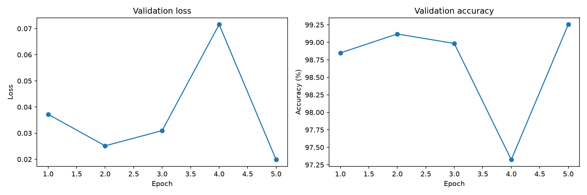
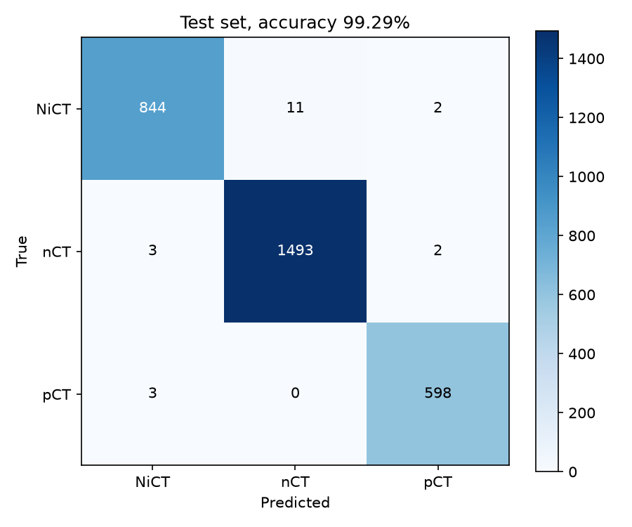

# COVID-19 CT Slice Classification

Classifies chest CT slices as normal (`nCT`), COVID-19 positive (`pCT`) or non-informative (`NiCT`) by fine-tuning an ImageNet-pretrained MobileNetV3-Large. Test accuracy is 99.29% on 2,956 slices.

For research and education only, not for clinical use.

## Data

The dataset is [CT Scans for COVID-19 Classification](https://www.kaggle.com/datasets/azaemon/preprocessed-ct-scans-for-covid19) (CC BY 4.0), with images from [iCTCF](http://ictcf.biocuckoo.cn/). Only the original, non-preprocessed slices are used.

| Class | Description | Slices |
|---|---|---:|
| `nCT` | Lungs visible, no signs of COVID-19 | 9,979 |
| `NiCT` | Too little lung visible to judge | 5,705 |
| `pCT` | Lung changes typical of COVID-19 pneumonia | 4,001 |

The non-informative class covers slices above and below the lungs, which every CT scan contains. The classes are imbalanced, so always predicting `nCT` would already give 50.7% accuracy.

Each class is shuffled with seed 42 and split 70/15/15, giving 13,778 training, 2,951 validation and 2,956 test slices.

## Method

The slices are 512 x 512 RGB images with identical channels. They are resized and center-cropped to 224 x 224 and normalised with ImageNet statistics. Training images also get random resized crops and horizontal flips.

The MobileNetV3-Large head is replaced with `Linear(960, 1280) -> ReLU -> Dropout(0.2) -> Linear(1280, 3)`, and the full network (4.2M parameters) is fine-tuned with cross-entropy loss and Adam (lr 1e-4, batch size 16) for 5 epochs. The checkpoint with the best validation accuracy is kept.

## Results

| Split | Accuracy | Loss |
|---|---:|---:|
| Validation | 99.25% | 0.0198 |
| Test | 99.29% | 0.0154 |

Validation accuracy passed 98.8% after the first epoch, dipped to 97.3% in epoch 4 and peaked at 99.25% in epoch 5.



On the test set:

| Class | Precision | Recall |
|---|---:|---:|
| NiCT | 99.3% | 98.5% |
| nCT | 99.3% | 99.7% |
| pCT | 99.3% | 99.5% |



The model made 21 errors. No COVID-positive slice was predicted as normal, which is the most serious error for screening. Three positive slices were predicted as non-informative. Most errors (11) were non-informative slices predicted as normal, likely borderline slices near the top or bottom of the lungs where some lung tissue is visible.
## Limitations

The split is per slice, not per patient. Each patient contributes several slices, so slices from the same person can appear in both training and test. The dataset has no patient IDs, and inspecting consecutive file numbers showed they come from different patients, so file order can't be used to group them either. Accuracy on unseen patients is likely lower than reported.

The model also classifies each slice on its own, without the rest of the scan. All images come from one source, and the results are from a single training run.

## Usage

Requires Python 3.12 and an NVIDIA GPU with CUDA.

```
python -m venv .venv
.venv\Scripts\activate
pip install torch torchvision --index-url https://download.pytorch.org/whl/cu128
pip install matplotlib ipykernel
```

Download the dataset from Kaggle and place the original slices here:

```
data/Original CT Scans/
├── nCT/
├── NiCT/
└── pCT/
```

Then run `explore.ipynb` from top to bottom. The best model is saved to `outputs/best_model.pt`.

Training took about 23 minutes on an RTX 3080 Laptop GPU with PyTorch 2.11 (CUDA 12.8).

## References

- Ning, W. et al. (2020). iCTCF: an integrative resource of chest computed tomography images and clinical features of patients with COVID-19 pneumonia.
- Howard, A. et al. (2019). [Searching for MobileNetV3](https://arxiv.org/abs/1905.02244). ICCV.